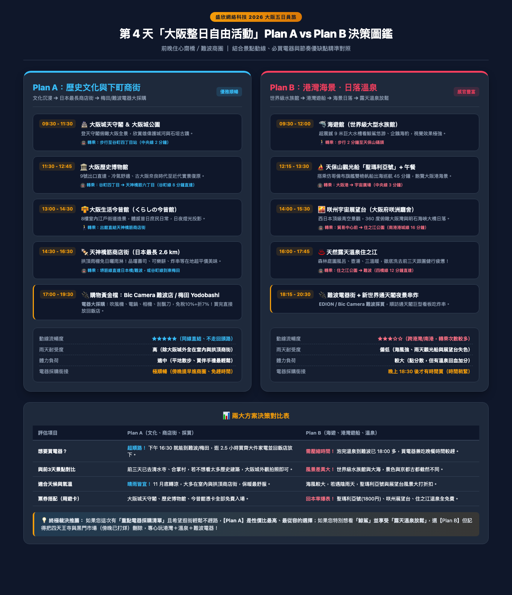
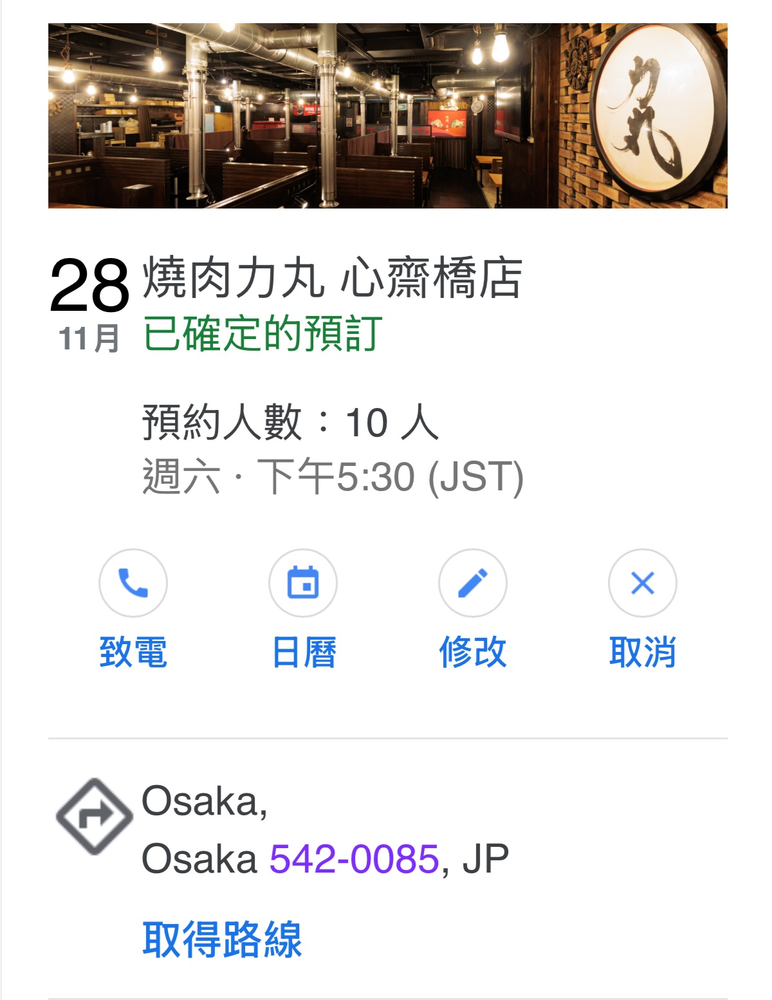

# 盛欣網絡科技有限公司 2026 大阪五日員工旅遊指南手冊 🇯🇵
> **SHENG XIN NETWORK TECHNOLOGY CO., LTD. — OSAKA TRIP 2026**  
> **旅遊期間**：2026 年 11 月 25 日（三）～ 2026 年 11 月 29 日（日）  
> **協辦旅行社**：旅天下聯合國際旅行社股份有限公司（業務窗口：蘇世欣 / 簡佑庭 `02-7701-0660#8502`）

---

## 📌 目錄
1. [航班資訊與行前集合關鍵時間軸](#-航班資訊與行前集合關鍵時間軸)
2. [行前交通與前一晚住宿戰略精算（台中 ➔ 高雄小港）](#-行前交通與前一晚住宿戰略精算)
3. [公司官方五日行程總覽](#-公司官方五日行程總覽)
4. [Day 4 自由活動雙方案深度企劃（Plan A vs Plan B）](#-day-4-自由活動雙方案深度企劃plan-a-vs-plan-b)
5. [大阪必買電器採購全攻略](#-大阪必買電器採購全攻略)
6. [日本自由行必備實用工具與 App](#-日本自由行必備實用工具與-app)

---

## ✈️ 航班資訊與行前集合關鍵時間軸

| 航程 | 出發日期 | 航班編號 | 航空公司 | 起飛機場 | 起飛時間 | 抵達機場 | 抵達時間 |
| :--- | :--- | :--- | :--- | :--- | :--- | :--- | :--- |
| **去程** | **2026/11/25 (三)** | **AK170** | 亞洲航空 (AirAsia) | 高雄小港 (KHH) | **08:30** | 大阪關西 (KIX) | **12:40** |
| **回程** | **2026/11/29 (日)** | **AK171** | 亞洲航空 (AirAsia) | 大阪關西 (KIX) | **13:45** | 高雄小港 (KHH) | **16:00** |

### ⏱️ 11/25（出發當天）關鍵時間死線：
* **06:30【團體集合時間】**：小港國際航廈 3F 大廳與盛欣同仁、領隊會合，發放護照與辦理團體托運。
* **07:30【廉航關櫃死線】**：⚠️ 亞洲航空於起飛前 60 分鐘準時電腦鎖定關櫃，超過 07:30 視同放棄機票。
* **08:10【登機門關閉】**：起飛前 20 分鐘關閉艙門。
* **08:30【班機起飛】**：準時起飛飛往日本關西海上空港。

---

## 🚄 行前交通與前一晚住宿戰略精算

### ⚠️ 為什麼當天清晨「絕對不能搭高鐵」？
* 台灣高鐵台中往高雄（左營）南下**每日首班車為 0583 次（06:25 發車 ➔ 07:30 抵達左營）**。
* 首班車 **07:30 才剛抵達左營**，而 AK170 航班也是 **07:30 準時關櫃截止報到**！從左營飆車至小港最快需 25 分鐘，抵達已超過 07:55，**100% 錯過航班**。
* **結論**：11/24（二）前一晚必須在高雄過夜。

---

### 🏨 前一晚住宿（已定案並全額付清）：【住小港機場旁・橙屋商旅】
* **狀態**：✅ **已確認預訂並全額付清（NT$ 1,580）**
* **入住日期**：2026 年 11 月 24 日（週二）
* **房型**：標準房（無窗）1 間
* **地址**：高雄市小港區大業北路 300 號（距小港機場車程約 3 分鐘，電話：`07-801-2266`）
* **匯款核銷紀錄**：
  * 轉帳時間：2026/11/12 09:46:21
  * 轉帳金額：NT$ 1,580（全額付清，手續費 $0）
  * 轉出帳號末四碼：`1828`（華南銀行，戶名：廖倫豪）
  * 交易序號：`4614526` / 金資序號：`7479883`
* **備品提醒**：飯店落實環保政策，**不提供一次性客房備品**（牙刷、牙膏、刮鬍刀、梳子、棉花棒、牙線、浴帽等），需自備。
* **隔日出發戰略**：
  * 11/25 清晨 06:00 起床梳洗，06:20 搭乘專車或計程車 3～5 分鐘直達小港國際航廈 3F 大廳。
  * 06:30 準時與盛欣同仁、領隊會合，時間最為餘裕無壓力。

---

## 🗺️ 公司官方五日行程總覽

* **第 1 天 (11/25)**：高雄小港 ✈ 大阪關西海上空港 ➔ 世界遺產【清水寺】、二三年坂京風小舖老街 ➔ 日式相撲鍋海鮮拼盤晚餐 ➔ 宿京都（URBAN 京都 / Mystays 京都四條 / MONday 京都同級）。
* **第 2 天 (11/26)**：米其林評鑑星級【伊根灣舟屋】搭乘海上遊覽船 ➔ 日本三景【天橋立】傘松公園搭乘纜車俯瞰「升天之龍」 ➔ 但馬牛壽喜燒長腳蟹海鮮鍋午餐 ➔ 宿京都。
* **第 3 天 (11/27)**：日本三大合掌村【美山町茅葺之里】合掌屋秘境 ➔ 免稅店 ➔ 難波～心齋橋～戎橋商店街～道頓堀 ➔ 宿大阪（心齋橋 Grand Hotel / 捷旅 Just Sleep 心齋橋 / Holiday Inn / 大阪本町 Route Inn 同級）。
* **第 4 天 (11/28)**：**全日自由活動（自主規劃行程，詳見下文 Plan A / Plan B）** ➔ 宿大阪。
* **第 5 天 (11/29)**：專車前往大阪關西空港 ✈ 高雄小港機場，平安賦歸。

---

## 📊 Day 4 自由活動雙方案深度企劃（Plan A vs Plan B）

### 方案 A：歷史文化與下町商街線（悠閒順暢、天候晴雨皆宜）
* **09:30 - 11:30**：**大阪城天守閣 ＆ 大阪城公園**（地鐵森之宮／谷町四丁目站）
* **11:30 - 12:45**：**大阪歷史博物館**（谷町四丁目 9 號出口直達，冷氣舒適、古大阪實景還原）
* **13:00 - 14:30**：**大阪生活今昔館**（谷町線搭至「天神橋筋六丁目站」直結，8 樓室內江戶街道造景）
* **14:30 - 16:30**：**天神橋筋商店街 ＆ 大阪天滿宮**（日本最長 2.6 km 拱頂遮雨棚商店街，平價庶民美食、中村屋可樂餅）
* **17:30 - 19:30**：🔥 **【全員晚宴預訂】燒肉力丸 心齋橋店**（**已確定預約！10 人・週六 17:30 JST**）
  * **地址**：日本〒542-0085 大阪市中央區心齋橋筋 2-1-32 ISビル 4F（[Google 地圖導航](https://www.google.com/maps/search/?api=1&query=%E7%87%92%E8%82%89%E5%8A%9B%E4%B8%88+%E5%BF%83%E6%96%8E%E6%A9%8B%E5%BA%97)）
  * **特色**：Google 4.5 ⭐ (5,858則) 人氣日式本格燒肉名店！厚切牛舌、極上牛小排炭火現烤。
  * **費用**：公司公基金（企業福利預算）全額支應。
  * **取消政策**：若行程異動，最晚需提前 2 小時通知取消。
  * 
* **19:30 - 21:30**：**電器大採購 ＆ 心齋橋/道頓堀夜景散策**（難波 Bic Camera / EDION 難波本店 / 梅田 Yodobashi，或阿倍野 HARUKAS 300 夜景）

### 方案 B：港灣海景・日落溫泉線（景觀反差大、徹底放鬆）
* **09:30 - 12:00**：**海遊館**（世界級水族館，9 米大水槽看鯨鯊、企鵝、海豹）
* **12:15 - 13:30**：**天保山觀光船「聖瑪利亞號」**（搭乘仿哥倫布旗艦雙桅帆船出海巡航 45 分鐘）
* **14:00 - 15:30**：**咲州宇宙展望台**（360 度俯瞰大阪灣海景與夕陽）
* **16:00 - 17:45**：**天然露天溫泉住之江**（森林庭園露天風呂、三溫暖，消除前幾天步行疲勞）
* **18:15 - 20:30**：**難波電器街 ＆ 新世界通天閣夜景**（買電器兼吃道地炸串）

---

## 🔌 大阪必買電器採購全攻略

| 電器旗艦店 | 地點與交通 | 營業時間 | 特色與推薦品項 |
| :--- | :--- | :--- | :--- |
| **Bic Camera 難波店** | 難波千日前（心齋橋筋往南走到底） | **10:00 - 21:00** | 7 層樓大賣場，吹風機、象印電鍋、刮鬍刀、相機庫存最齊，免稅10%+折7% |
| **EDION 難波本店** | 難波站正對面（9層樓巨型旗艦） | **10:00 - 21:00** | 動線寬敞舒服，家電展示齊全，中文服務員充足 |
| **Yodobashi 梅田店** | JR 大阪站 / 梅田站旁 | **09:30 - 22:00** | 全日本最大規模，音響耳機、電腦零件、攝影器材庫存怪獸 |

### 💡 實戰血拼小提醒：
1. **護照隨身帶**：免稅（Tax Free 10%）必須出示實體護照。
2. **出示優惠券條碼**：手機出示 Bic Camera / EDION 7% 折扣券，合計現省 17%。
3. **託運包裝**：電鍋、水波爐等大件家電結帳時告知「Carry on flight / Check-in baggage」，店員會以原廠紙箱並加裝堅固塑膠提把包裝，可直接托運。

---

## 📱 日本自由行必備實用工具與 App

1. **Google Maps**：日本大眾運輸換乘、步行導航精準度 100%。
2. **乘換案內（乗換案内）**：查詢地鐵發車時刻表、月台番號與轉乘最佳車廂。
3. **Tabelog（食べログ）**：日本在美食評分指南，評分 3.5 分以上皆為超強名店。
4. **Visit Japan Web**：出發前上網填寫入境查驗與海關申報，入境直接刷 QR Code 快速通關。

---
*© 2026 Sheng Xin Network Technology Co., Ltd. All Rights Reserved.*
